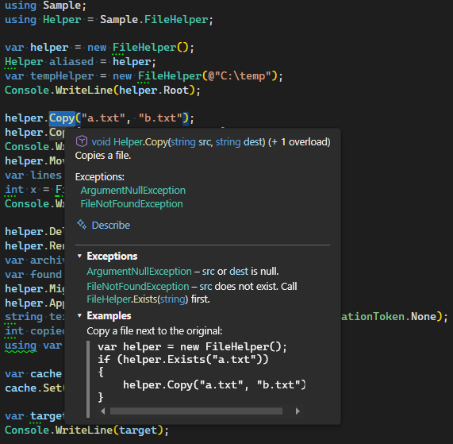

# QuickInfo Plus

A Visual Studio extension that adds what the C# Quick Info tooltip leaves out of XML documentation comments:
your `<example>` sections and the descriptions of your `<exception>` tags — with clickable, summary-colored
references and copyable code.

Works in **Visual Studio 2026 (18.x)** and **Visual Studio 2022 (17.x)**, C# only.

## What it adds to the tooltip

Hover a C# method, constructor, property or type. Below VS's own tooltip, QuickInfo Plus adds two collapsible
sections:



- **Exceptions** — each `<exception cref>` with its description beside the type (VS's own list shows the types
  only). Left out when no exception has a description.
- **Examples** — the `<example>` text and `<code>` blocks.
- **Click a header** to expand or collapse a section. Each section remembers its state until Visual Studio
  closes and starts collapsed when VS starts.
- **References read like VS's summary**: `<see cref>` shows as `FileHelper.Exists(string)`, colored like the
  summary, with each part (`FileHelper`, `Exists`, `string`) its own link — click for Go To Definition, hover for
  a hint. `<typeparamref>` shows the actual type at the call (`int` at `Map<int>(1)`).
- **Web links** (`<see href="https://…">`) open in your browser. Other link types stay plain text.
- **Code blocks** keep their line breaks and relative indentation, use your editor font, and have an accent bar
  on the left. Select code with the mouse and press **Ctrl+C**, or click the **copy icon** at the right to copy the
  whole block. Right-click is ignored inside code.
- `<para>`, `<br/>` and `<list>` (bullets, numbers, term – description) are laid out like VS's summary.
- Works for your own code and for referenced assemblies / NuGet packages that ship an XML documentation file,
  including generic and extension-method calls and `using` aliases.

## Options

**Tools ▸ Options ▸ QuickInfo Plus ▸ General** (in VS 2026 the entry opens the classic options dialog):

- **Show Exceptions section** — on by default.
- **Show Examples section** — on by default.
- **Examples section ▸ Maximum height (px)** — 300 by default, 100 to 1000. Longer examples scroll.

Changes apply on the next hover; no restart.

## Install

Double-click `QuickInfoPlus.vsix` (or run `VSIXInstaller.exe QuickInfoPlus.vsix`), choose the Visual Studio
versions to install into, and restart Visual Studio. Uninstall from **Extensions ▸ Manage Extensions**.

If the sections or the **QuickInfo Plus** Options page don't appear after installing, close Visual Studio, run
`devenv /updateconfiguration` once from a Developer Command Prompt (add `/rootsuffix Exp` for the Experimental
Instance), and start Visual Studio again.

## Known limits

- The sections appear **at the bottom** of the tooltip: an extension cannot insert text between VS's own
  signature, summary and exception list. Exception types therefore appear twice (VS's list and ours).
- The sections take the width of VS's part of the tooltip (at least 300 px). The Examples section is at most
  **300 px** high by default (adjustable in Options); longer examples scroll (mouse wheel anywhere, Shift + wheel
  sideways over code). The tooltip never grows past the top or bottom of the screen: if the screen is too small,
  Examples gets shorter first, and Exceptions scrolls only when even that is not enough. VS's own part cannot be
  shortened by an extension.
- Code blocks are not syntax-colored.
- `<inheritdoc/>` and `<include>` are not resolved.

## Build

Requirements: Visual Studio 2026, or Visual Studio 2022 17.13 or later (to open `QuickInfoPlus.slnx`), with the
**Visual Studio extension development** workload.

```powershell
& "MSBuild.exe" QuickInfoPlus.slnx /restore /p:Configuration=Release
dotnet test tests\QuickInfoPlus.Core.Tests -c Release
```

The package is written to `artifacts\Release\QuickInfoPlus.vsix` (Debug builds: `artifacts\Debug\`). The
`artifacts` folder is ignored by git. Builds don't install the extension anywhere.

The extension icon's source is `src\QuickInfoPlus\Resources\icon.svg`. After editing it, run
`pwsh tools\export-icon.ps1` (needs Edge or Chrome) to regenerate `icon.png` and commit both files.

To debug, build with `/p:DeployExtension=true` to install it into the Visual Studio Experimental Instance, then
start that instance (`devenv /rootsuffix Exp`, or **F5** with **QuickInfoPlus** as the startup project; F5's own
build doesn't install the extension):

```powershell
& "MSBuild.exe" QuickInfoPlus.slnx /restore /p:Configuration=Debug /p:DeployExtension=true
devenv /rootsuffix Exp /updateconfiguration
```

`samples\Sample` contains doc comments that exercise every feature. Run the `/updateconfiguration` line after
each deploy; without it the Experimental Instance sometimes doesn't pick up the extension.

The first deploy after the extension was uninstalled from the Experimental Instance fails with
`VSSDK1031: Extension ... could not be found`: the files are copied, but VS 2026's extension cache doesn't know
the extension yet. Run the `/updateconfiguration` line, then build with `/p:DeployExtension=true` again.

## Project layout

| Folder | Contents |
| --- | --- |
| `src/QuickInfoPlus.Core` | All doc-comment logic: parsing, indentation, symbol lookup, summary-style names, colors, hints. No Visual Studio dependencies. |
| `src/QuickInfoPlus` | The VSIX: Quick Info source, tooltip view, Options page, Ctrl+C handler. |
| `tests/QuickInfoPlus.Core.Tests` | xUnit tests for the Core library, using real Roslyn workspaces. |
| `samples/Sample` | A small console project for trying the extension by hand. |
